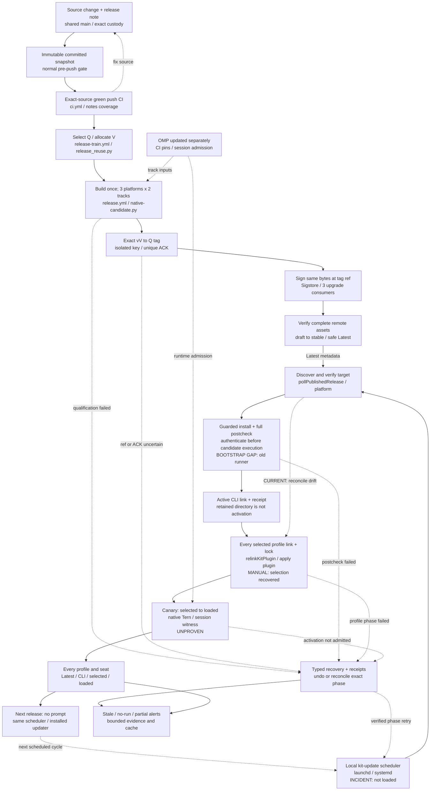

# Release procedure

How any fleet repo cuts a versioned release (PUB1c). The companion repo is
the reference implementation; uds adopts this same procedure next.

## End-to-end contract: published, installed, selected, and loaded are different

The release environment is complete only when a substantive source change reaches
the running agents without a person selecting a version, switching links, or
prompting the next upgrade. A GitHub release alone is not that outcome.

This is the single canonical map. Solid edges describe the implemented path;
dashed recovery/reconciliation edges are requirements whose deployed behavior must
be demonstrated. “Source-wired” does not mean installed, enabled, loaded, or tested
on the operator's machine.



### Observed incident, not version-pinned configuration

| Boundary | Observed state on 2026-10-18 | What that proves |
|---|---|---|
| Published release | Stable Latest `v0.2.48`, seven assets, exact source `687e6f4d521d29cab9a7c62fd8331566a1183292` | One real automatic publication; not five releases or local uptake |
| Shipping consumers | Native run `39139419077`: all three signed installer/compiled-upgrade receipts say `0.2.39` to `0.2.48` | Real GitHub-hosted upgrade execution; not the operator fleet's loaded version |
| Operator CLI | Initially `0.2.38`; later manual reconciliation `591c512d…` activated `0.2.48`. Native link and binary SHA `68b5e672…` independently match the signed release. | Actual local CLI recovery, not an automatic scheduled update |
| Profile selection | Initially selected `0.2.37`; manual plugin receipt `4f1b55b4…` applied the 20 existing kit profiles plus default to `0.2.48`; all 21 actual links independently match. Four unmanaged profiles were left alone. | Package selection recovered. Already-running sessions are a separate boundary. |
| Chief's OMP runtime | `18.12.1` | OMP and kit update independently |
| Local scheduler | `service status kit-update --json`: installed, `loaded:false`, no recorded run | A plist on disk is not an active automatic update loop |
| Postcheck observations | The old 0.2.38 updater's 16:45–16:48 check still produced 109/110 with zero foreign writes. Its runtime lacks the source-cache environment support used by Tern's compiled OMP. Earlier direct candidate testing separately exposed a foreign legacy-cron writer and an owned-work-root emulation leak. | The old updater's harness can reject a healthy candidate; quiescence alone does not repair that bootstrap boundary. |
| Candidate-owned local check | Actual 0.2.48 binary, 16:50–16:53: PASS/exit 0 on OMP 18.12.1, all 11 stages, G4 110/110 and plant PASS; 8,588 watched HOME paths unchanged, project unchanged, release unchanged. | Supports the explicit receipt-checked reconciliation, not automatic polling, loaded extensions or five cycles |
| Retained target | Old attempt `d712708b…` was compensated; its byte-identical target was preserved by the operator before the new attempt. New receipt `591c512d…` is RECONCILED. | Preserve recovery evidence; never infer activation or permission to clobber from a directory's presence. |
| Delivery owner | Existing P0 `ompkit-v66l.22` FLEETUPG1 | Local postcheck isolation, profile/loaded inventory, canary activation and next-release automatic uptake remain open |

The versions above are evidence from one incident. The implementation must
discover the next verified publication; none is an admission constant or a target
that an operator must update by hand.

### Version-question acceptance: CLI-current is not session-current

A real test session read a globally resolved `omp-kit` skill, ran only
`omp-kit --version`, saw `0.2.48`, and concluded “No update is needed.”
That conclusion is unsupported. The native version producer must report
published release, resolved CLI, this profile's selected package/link/lock, and
actual loaded session code separately. Missing loaded evidence is UNKNOWN, not
current and not automatic permission to restart.

The skill's own `version: 0.1.0` is independent metadata, not a kit release.
Its resolved origin and stale private-source install instructions are a separate
instruction-shadowing issue. Inventory effective skill/rule/extension origins;
neither a skill metadata version nor a CLI version proves the other layers.
Provider/advisor quota warnings do not establish any kit-version fact.


### Executable edges and ownership

| Edge | Producer and consumer | Required admission and output | Proof status |
|---|---|---|---|
| Work to published source | Exact reserved paths, native commit guard, `scripts/pre-push-gate.sh`, `scripts/fresh-gate.sh`; fleet's external `git_converge.py` | Publish the committed shared-main snapshot. Live unrelated dirty files are not artifact inputs. Foreign editing leases must not be mistaken for ownership of immutable committed bytes. | Native shared-main publication observed; editing/publication lease coupling remains a separate known gap. |
| Source to green CI | `.github/workflows/ci.yml`, `scripts/check-pushed-notes.sh`, `scripts/release-notes.sh` | Actual successful push CI for exact source; full unreleased-range notes from a verified published ancestor. A schedule, tag, cached green label or running attempt is not qualification. | Proven for frozen release source Q; it does not qualify newer main or erase its failures. |
| Completion to allocation | `.github/workflows/release-train.yml`, `scripts/release_reuse.py` `_drive`, `_dispatch_allocation`, `_watch_plan` | Canonical workflow paths, main ancestry, one active train, immutable owner/attempt, notes digest and native dispatch acknowledgement. Cron is missed-event recovery, not a replacement for completion events. | One natural completion-to-publication cycle observed; five cycles and latency targets remain unmet. |
| Allocation to final-version candidate | `.github/workflows/release.yml`, `scripts/package-release.sh`, `scripts/package-release.ts`, `scripts/native-candidate.py` | One final-version build; exact archive/index/manifest/SBOM identities and both certified OMP tracks on each shipping platform. The optional Intel probe is advisory. | Real final-version qualification reused; no operator bootstrap or rehearsal counted as a new cycle. |
| Candidate to tag | `release-train.yml` `publish` then `tag-qualified`; `release_reuse.py` `require-allocation`, `require-green`, `promotion`, `require-attempt`, `require-created-ref` | Revalidate exact qualified authority before loading the repository-only SSH key. No candidate executable/build in the key-bearing job. Require unique native new-ref acknowledgement and direct remote `vV -> Q`; never force or rebind. | Native bot-created historical-Q tag observed; local refusal/race tests are not extra live release cycles. |
| Tag to signatures and upgrade evidence | `release.yml` `reuse-evidence`, `attest`, `attest-index`, `signed-consumers`; `release_reuse.py` `_require_signed_consumers` | Sign the already certified bytes from the tag-ref workflow. Require exact issuer/workflow/source/ref and genuine older published-version upgrades. Three local fixture runs or green job titles alone are not receipts. | Exact public index signature verified; three native 0.2.39-to-0.2.48 receipts read. Next released updater's upgrade remains required. |
| Signed evidence to public release | `release-train.yml` sign-phase `publish`; `release_reuse.py` `_verify_final`, `_repair_release`, `_latest_flag` | Verify every required existing remote asset; upload only absent exact bytes. Publish the draft only after complete authority/asset checks. An older recovered cut cannot regress Latest. | Stable Latest and all seven canonical assets observed for one cut. |
| Loaded local timer to Latest query | Registered `kit-update` service; `src/cli.ts` service dispatcher; `src/kit-update-job.ts` `pollPublishedRelease` | Scheduler actually loaded, enabled GitHub polling, ordinary read credentials, native `gh` available in the service environment, correct platform and monotonic target. Polling is already called before the optional static fallback. | Source-wired in released code; operator job is installed but not loaded. Publication does not bootstrap it. |
| Poll to guarded update | `pollPublishedRelease`, `src/kit-update.ts` `planKitUpdate` / `applyKitUpdate`, `installer/install.sh` | Same-directory verified index/archive, digest-bound attestation bundle, safe target/prefix and exact prior/postimages. Existing target, pending receipt and failed download need explicit recovery, not clobbering. | Hosted consumers passed. Operator's d712 attempt was explicitly undone: receipt `ABORTED_AFTER_COMPENSATION`, activation `RESTORED`. PARTIAL alone does not prove undo. |
| CLI update to profile selection | Direct CLI's successful-update branch and `runKitUpdateJob` call `relinkKitPlugin`; `apply plugin --apply --yes --store … --profiles all --include-default` | Verify complete, unique profile coverage, package identity and mutation receipt. Both direct CLI and job skip relink after PARTIAL; only the job also reconciles its service. | Relink exists in immutable 0.2.38/0.2.48 source. The failed operator attempt did not reach it; that is not proof the implementation is absent. |
| Selected package to loaded kit | Native OMP/Tern activation at qualified safe boundaries, actual session witness and version inventory | Distinguish rules/skills/MCP reload from extension process restart. Never hot-interrupt busy or human-paused seats. A symlink, lockfile or CLI version does not prove which extensions a running agent loaded. | Canary and complete loaded-version reporting are not yet proven. |
| Completed uptake to next uptake | Loaded scheduler, installed updater, durable failure state, inventory and notifier | Demonstrate the next genuine publication with no chief prompt. Reconcile profile/service/loaded drift even when the CLI already reports CURRENT; do not silently forget an incomplete phase. | Unmet. Same-CLI reconciliation, partial-phase recovery and a real next-release tick still require proof. |

### Prerequisites, credentials, and independent version domains

| Domain | Required input or tooling | Boundary |
|---|---|---|
| Repository publication | Shared `main`, real push CI, native Git/GitHub CLI, available owner artifacts | Never qualify a private-index side history, an unpublished reservation tag, or an author-supplied run title. |
| GitHub coordination | Ordinary workflow `GITHUB_TOKEN` with the job's declared contents/actions permissions | Command-local `gh auth git-credential` supports admitted private Git reads without persisted checkout credentials. It is not the tag authority or a personal-token fallback. |
| Tag authority | `release-tag` environment; `RELEASE_DEPLOY_KEY`; nonsecret `RELEASE_DEPLOY_KEY_FINGERPRINT`; expected GitHub host key | Repository write deploy keys are not intrinsically tag-only credentials. Main-only environment admission, protected immutable release tags, isolated short-lived SSH agent, bounded push, verified remote ref and cleanup are separate controls. |
| Attestation | GitHub-hosted tag-ref workflow, OIDC and attestation permissions; native `gh attestation verify` | Require exact repository, issuer, signer workflow, source digest and ref. A digest or green job name alone is not a signature. |
| Local scheduled process | Stable kit launcher, native `gh` and ordinary read authentication in its actual noninteractive environment, supported platform, private service temp/state paths | A terminal's PATH/authentication does not prove the launchd/systemd job has them. A plist/unit is not loaded or recently successful. |
| Poll configuration | `OMP_KIT_UPDATE_ENABLED=1`, `OMP_KIT_UPDATE_POLL=github`, `OMP_KIT_UPDATE_REPO=owner/repo` | Configure the repository once, not a release number. Static `INDEX`/`ARCHIVE`/`VERSION`/`SOURCE_TAG` inputs are an explicit fallback, not the normal automatic loop. |
| Native OMP | Independently installed runtime and source/native identity; source-pinned CI minimum/certified tracks | Kit update does not install or silently change OMP. Record the actual session runtime separately from package/CLI/loaded-kit identity. |
| Profile selection | Discover profiles plus default, kit package identity, symlink/directory and lockfile snapshots | Do not equate a lockfile's package version, a release manifest version, a selected store and in-memory loaded extensions without their own evidence. |
| Legacy/global skill, extension and rule copies | Resolved `skill://` origins, `src/apply-extensions.ts`, profile extension entries and effective rule/extension origins | Global skills, standalone copied extensions and local overlays are separate from the plugin symlink. Inventory origin/hash/precedence; migrate explicitly owned bytes with receipts. Do not silently delete custom policy or equate selected package with all effective instructions/code. |
| Runtime admission | Qualified Tern seat identity, idle/paused/busy state, approved reload/restart route and loaded-version witness | `tern inspect --json` and native session records are observation tools. A queued request, send exit code or source file on disk is not activation proof. |
| Capacity and retention | Disk headroom, bounded jobs/network calls, bounded logs/cache, retained known-good version and unresolved receipts | Fail explicitly on unavailable prerequisites. Do not purge active versions or recovery evidence to make an update pass. |

### Repair and rollout order for the observed incident

The existing FLEETUPG1 owner executes the local-state changes; the map is not a
parallel installer or a second activation authority.

1. **Inventory first.** Produce one row per profile/active seat: desired published
   release, CLI executable/manifest, selected plugin store/package/lock, actual
   loaded kit witness, OMP runtime, stale/unknown reason and last successful tick.
   Preserve UNKNOWN for a missing loaded witness; do not infer memory from links.
2. **Diagnose the real postcheck.** Bind the failed receipt and exact scenario
   manifest to its source/runtime. Separate the missing scenario from foreign
   state changes with causal controls. Keep both missing-result rejection and
   genuine tested-process write detection intact.
3. **Recover the existing attempt.** Inspect the rollback receipt and retained
   target's verified bytes/references. Use supported verified reuse, receipt
   reconcile or undo as applicable. `KIT_TARGET_EXISTS` is not authority to delete,
   overwrite or pretend the directory is active.
4. **Prove CLI and profile application.** Let the guarded job install and postcheck,
   then apply the exact verified store to every selected profile and default.
   Read both mutation receipts and every postimage; retain the previous good state.
5. **Activate a canary.** At an admitted safe boundary, reload rules/skills/MCP
   where supported; extension changes require the qualified in-place restart
   route and an actual loaded-version witness. Unqualified restart tooling is
   not a workaround. Expand to remaining seats only after canary health passes.
6. **Load and verify the scheduler.** Use the native `service install kit-update`
   dry-run/apply/backup/bootstrap path under the approved owner. Read back
   `service status kit-update --json` and `service doctor kit-update --json`.
   Prove an independent scheduled run; a successful manual `service run` is not
   proof that the periodic job is loaded or will survive login/reboot.
7. **Prove the next release.** A genuinely newer certified publication must reach
   the installed updater, every selected profile and running canary/fleet seats
   without a chief prompt. Preserve the real previous-version upgrade evidence.
8. **Exercise recovery before claiming reliability.** Test failed download,
   invalid signature/bytes, retained target, failed/missing scenario, concurrent
   foreign write, partial relink, service reconcile failure, busy/human-paused
   seat, failed canary, interruption and the next successful independent tick.
   The expected result is a truthful incomplete state and safe retry/undo, never
   an OK envelope hiding stale agents.

### Local state machine and non-negotiable recovery

- **Discovery:** disabled, unavailable metadata, unauthenticated service, no newer
  publication, downloaded-but-unverified, and eligible update are different states.
  A network/auth failure is not `CURRENT`.
- **Retryable staging:** a prior `poll-V` directory or attestation sidecar can
  survive failure. Reuse only validated matching bytes or a new owned staging
  attempt; never blindly overwrite unverified files.
- **Installation:** a retained release directory does not prove activation.
  Recover using the original receipt, exact postimages and declared undo/reconcile
  path. Keep the prior verified version available.
- **Candidate-owned validation:** switching the CLI link does not replace the
  already-running old updater's imported harness/runtime. Authenticate the candidate
  before execution, then run its version-bound postcheck in a separate process
  with the correct native manager/source/cache environment. The old-updater/new-
  candidate/Tern-source-cache combination must be covered, not just npm-managed
  hosted consumers. Missing scenario results still fail.
- **Compensation truth:** `applyKitUpdate` may return PARTIAL with the new CLI
  still active. `undoKitUpdate` is a separate, receipt/postimage-checked action.
  The job currently labels PARTIAL as UNDONE without calling that action; neither
  the label nor its notification proves the old link was restored.
- **Postcheck:** require the candidate manifest's complete expected named-result
  set, not a fixed scenario-count constant. In this incident, 109/110 was a failure.
  Attribute effects using isolated state and an adversarial foreign-write control;
  retain genuine tested-process write detection. Empty, missing or unjudged
  runs must not aggregate to OK; never widen the denominator or hide failed runs.
- **Profile phase:** a successful CLI switch with a failed or partial plugin
  relink is incomplete uptake. Preserve both kit and plugin receipts. The next tick
  must repair this phase even when no newer CLI version exists.
- **Activation phase:** first prove a canary's selected package, actual loaded
  extensions and healthy behavior. Expand only after its readback succeeds.
  Preserve human pause, identity ambiguity and busy-seat protection.
- **Scheduler self-update:** service reconciliation must not kill its own active
  update before a terminal receipt is durable. Preserve or restore the loaded job
  and prove the next independent scheduled tick.
- **Visibility and retention:** report Latest, installed CLI, profile selection,
  lock identity and actual loaded kit separately. Alert on stale/no-run/partial
  states. Bound downloaded archives, logs and receipts without deleting active
  versions, unresolved recovery evidence or a live process's files.

### Proven breaks and source-visible recovery gaps

Source-only branches are distinguished below from the observed old-harness failure:

1. The job maps `applyKitUpdate` PARTIAL to UNDONE and says undo completed, but
   the apply path returns PARTIAL without compensation and the job never calls
   separate `undoKitUpdate`. Verify actual active-link/receipt postimages; fix
   the missing effect or the false status before claiming automatic rollback.
2. The job returns CURRENT before pending-recovery, profile and service
   reconciliation when no newer CLI is found. A partial update can leave the
   latest CLI active with unresolved recovery; CURRENT must not hide that state.
   The normal relink path is reached only after UPDATED.
3. A relink or service-reconcile failure returns UPDATED with a failure reason;
   the service dispatcher maps that status to OK/exit 0. That is not full uptake.
4. Fixed per-version poll staging, non-clobbering downloads and exclusive-create
   bundle files need a real failed-attempt/repeated-tick recovery proof.
5. The local scheduler was observed unloaded. Manual CLI/profile recovery and
   one quiet-window check do not prove automatic updates under normal fleet load.
6. The actual old updater ran candidate checks through old runtime code, producing
   a missing scenario on Tern's managed-source layout. The candidate-owned check
   passed all 110 scenarios on the same verified tree. Permanent self-update must
   validate the candidate with its own authenticated code, not pin an old harness.

For every edge, acceptance requires a positive native transition, a causal
negative that blocks the unsafe transition, an exact source/artifact/operation
identity, and a preserved recovery result. The final acceptance is a subsequent
release reaching running canary and fleet agents without a prompt, not completion
of this document.


## 1. Fragments, every commit

`CHANGELOG.md` has the upstream oh-my-pi shape (can1357/oh-my-pi AGENTS.md
"Changelog"): `## [Unreleased]`, then `## [X.Y.Z] - YYYY-MM-DD` sections with
`### Breaking Changes|Added|Changed|Fixed|Removed` buckets, one user-facing line
per entry; released sections are immutable. Notes reach `[Unreleased]` through
`changelog.d/<bead>.md` fragments (bullets, optional first line
`### Category`, default Changed), so concurrent agents never edit one file.

Each change ships with a fragment, or a `[no-changelog]` reason in the commit
message. The release workflow enforces it:

```sh
sh scripts/release-notes.sh check --base-tag vX.Y.Z --head REF
```

A commit touching shipped paths without coverage fails the check. The pre-push gate
(`scripts/check-pushed-notes.sh` via `fresh-gate.sh`) calls this same checker with
`--base-ref` for its exact pushed range; it does not maintain a second parser.
A fragment folded into source-owned `CHANGELOG.md` entries still covers its commit.

When a remote push base is absent, the gate checks from the newest available stable
published ancestor of the immutable source. Main-push CI checks the full unreleased
range from that published ancestor before it can become green. Both use the release
controller's published-ancestor selection: draft, prerelease, unpublished reservation
tags and publications after the checked source cannot narrow its coverage. A missing
published floor or unavailable metadata refuses validation; neither silently skips it.

## 2. Optional changelog bookkeeping (not a release prerequisite)

```sh
sh scripts/release-notes.sh fold            # preview: fragments -> [Unreleased]; --write applies
sh scripts/release-train.sh bump --version X.Y.Z --date YYYY-MM-DD
```

`bump` runs `release-notes.sh promote --write` (fold, rename `[Unreleased]` to
`## [X.Y.Z] - DATE`, open a fresh `[Unreleased]`, set package.json `version` and
`omp.version`) and commits `chore: bump version to X.Y.Z`, the upstream
`scripts/release.ts` commit. With no entries and no fragments it refuses
(exit 4): there is nothing to release and no empty release body is ever cut.
`release-notes.sh notes --version X.Y.Z [--floor X.Y.Z]` prints the GitHub
release body from the CHANGELOG section(s), like upstream
`scripts/ci-release-notes.ts`, and refuses an absent or empty section.

These are explicit repository-maintenance commands, not the automatic train's
preparation step. The train never rewrites main or manufactures a bump on an
older green source. It selects immutable source `Q`, assigns artifact version
`V`, and renders only new notes since the preceding published ancestor:

```sh
sh scripts/release-notes.sh source --base-tag vPREVIOUS --head SOURCE_SHA --version X.Y.Z --output NOTES_PATH
```

The release manifest is authoritative for the installed version; source
`package.json` need not equal the selected artifact version. An unchanged
executable hash does not imply a misversioned archive.

## 3. Qualified semver promotion (manual fallback uses the same gates)

Tags are `vX.Y.Z` on the exact qualified source, created only after the final
version's three-platform/both-OMP-track candidate is successful and its archive
hashes and source-bound nonempty notes verify. Do not manually tag an uncertified
source. For an intentional cut when automatic triggering is unavailable:

```sh
gh workflow run release-train.yml --ref main -f sha=SOURCE_SHA -f version=X.Y.Z
```

The controller verifies actual main push CI and the ancestry-selected qualified
frontier; this is not an override for red/running/older sources. Version overrides
must meet the remote tag and changelog floor. Repository history stays shared
and unchanged; no branch rewind, side-history push or main freeze is needed.

### 3a. Rehearse before spending the version

A tag cannot be rebound. Rehearse before an intentional cut, without spending
its real version:

```sh
gh workflow run release.yml --ref main -f version=X.Y.Z -f rehearsal=true
```

The rehearsal runs changelog coverage, full native candidate certification,
platform validation and SBOM generation on `X.Y.Z-rehearsal.RUN.ATTEMPT`.
It refuses spent versions, creates no tag/release, and performs no signing.
It is not publication proof and cannot be relabeled as final-version evidence.
Production qualification uses final `V` from the start. A post-certification
signing/publication failure recovers from that same successful candidate run
(`candidate_run_id` on the train); it never rebuilds archives or moves a tag.

## 4. Build platform archives with sha256

```sh
sh scripts/package-release.sh --version X.Y.Z --platform darwin-arm64-none --out ABSOLUTE_DIR
```

Repeat per platform. `release-index.json` lists every archive with its
sha256; the installer (`installer/install.sh --version X.Y.Z --index URL
--prefix DIR`) verifies the hash before installing and refuses on mismatch.
Release candidate indexes contain exactly `darwin-arm64-none`, `linux-arm64-gnu`,
and `linux-x64-gnu`. `darwin-x64-none` is a non-shipping CI probe and is
excluded from published indexes and attestations. The publisher dispatches
`.github/workflows/release-intel-probe.yml` separately after shipping qualification;
its reported result never gates publication or holds the shipping train.
Release-mode candidate generation requires both minimum and certified OMP receipts for all three
ship targets; a missing or refused ship receipt blocks attestation.

## 5. Signing (delegated)

The existing release workflow signs the archives, SBOM and release index.
Qualification first produces final-version bytes without a tag. After the
promotion gate creates `vV -> Q`, the same workflow runs at that tag with
`certified_run_id`, downloads and verifies the qualified archives, and signs
them without rebuilding. The source installer/updater policy requires the GitHub
Actions OIDC issuer, exact `release.yml` signer and source digest `Q` fences.
Checking out `Q` in a workflow executing at newer main `H` is not sufficient
signing identity. Source policy is not proof that a fleet installation has adopted it.

## 6. Publish and install-check

The sign phase exercises the installer and a genuine released-to-released upgrade
against the signed final candidate before publication. After publication, the
operator's automatic poll/install/profile/activation chain must also be proved.

### Pending update receipts

An update can return PARTIAL while the new CLI remains active; pending recovery
then blocks successor updates. Inspect `omp-kit audit --json`, the activation
receipt, actual link and both recorded binary postimages.

For an eligible pending READY receipt only, `omp-kit update --reconcile RECEIPT --yes`
rescans the active kit link, release bytes and recorded postimages. It marks
RECONCILED only when those match. This records state consistency, not a passing
missing scenario or a repaired health regression. Fix or explicitly undo a real
failed postcheck; do not use receipt reconciliation to relabel it healthy.

The prefix is derived from the receipt; an explicit relocated `--prefix PATH`
must match the same postimages. A mismatch stays pending. A receipt already
ABORTED_AFTER_COMPENSATION with activation RESTORED is not this READY path, and
its retained release directory must not be deleted or overwritten to force retry.

## 7. Release train (RELTRAIN1, automatic; manual cut is the fallback)

Each CI main push completion wakes the existing controller. It reconciles
the newest qualified source by main ancestry, not the event's order or current
branch head. A red/running descendant does not invalidate an eligible green
ancestor; an actually newer green supersedes pending older sources.

- The `release-train-active` **job** lock is held from selection/version allocation
  through candidate certification, tag-ref signing and publication outcome.
  New commits never cancel an active release. The next admitted train re-reads
  qualification after waiting; three queued greens collapse to the newest.
- The publisher uses its own `release-train-publish` job group. There is no shared
  workflow-level concurrency group that could suppress publication or deadlock
  against the waiting train.
- Qualified source `Q` is in main history and has real completed successful push
  CI from `ci.yml`; OMP-certification, schedules, failed/cancelled/latest-running
  attempts and fabricated manual verdicts do not qualify it.
- Final artifact version `V` is allocated above stable tag reservations,
  actual stable GitHub publications and changelog floors. The changelog floor
  comes from the immutable fetched admission-main SHA
  (`next-version --changelog-ref`), not a stale controller checkout. A missing
  tag cannot make an already-published version reusable or globally block
  native recovery. No main bookkeeping bump is required. Empty source-range notes skip
  before dispatch. The owning train first uploads immutable `release-allocation-N`
  (native owner run/attempt, `Q,V`, notes floor/digest and retry policy), then uses
  the native dispatch response to upload `release-qualification-N` binding the
  exact qualification run ID. That acknowledged ID is atomically persisted
  before observer-state writes or eventual child metadata reads; binding upload
  runs even after a later dispatch-step failure. Code identity is independently
  resolved from the bound native run, with a bounded read-availability window.
  Qualification cannot authorize itself with inputs, a title or an unrelated
  active train. Promotion reloads owner authority after the original owner ends.
- `release.yml` first qualifies exact `Q,V`. Promotion verifies producer
  repository/workflow/ref/attempt, all three ship targets, both pinned OMP tracks,
  archive hashes and notes before tagging. A second, tag-ref run signs **those
  same bytes**, and publication verifies real Sigstore authority before creating
  the release. A recovered older release cannot take Latest from a newer
  published version; an unrelated unpublished tag is not a publication outcome.
- Non-superseded successful unfinished candidates are resumed rather than allocating their
  untagged in-flight version again. Failed exact-source qualification requires
  diagnosis forward, not an automatic rerun or a weakened gate. Unpublished tags
  reserve their version numbers without locking the scheduler or hiding an
  authenticated in-flight candidate. Native active or unresolved runs prevent
  competing allocation; eligible source history and notes use a published
  ancestor floor, not the highest unpublished tag. No tag is deleted or reused.
- Same-repository workflow names and `head_branch=main` are not code trust: a tag
  can also be named main. Shared authority validation fetches literal
  `refs/heads/main` from the expected repository into a dedicated full ref,
  completes shallow history, then proves both owner and qualification execution
  SHAs (and selected `Q`) are ancestors of that actual main tip. Historical
  main code remains valid; neither caller main SHAs nor caller-controlled origin
  or ambiguous short-main lookup can grant authority.
- A native-confirmed failed/canceled terminal run with no binding is not signing
  authority and cannot poison a new allocation. Inflight, successful-unbound,
  or unknown states stay conservative; lost authority is never reconstructed
  from a candidate's own selection or title.
- Explicit `same-native-run` retry authorization preserves the immutable dispatch
  inputs and execution head; it never authorizes a second qualification run ID.
  Every accepted latest successful attempt needs a complete unique artifact
  snapshot: attempt-qualified names, native producer IDs and creation timestamps
  within the actual native attempt. Missing/mixed attribution or a newer
  running/failed attempt refuses. Signing still copies certified bytes, not builds.
- Publication creates a draft until all mandatory archive/SBOM/index assets and
  Sigstore authority verify. An existing matching index alone is not completion.
  Existing required assets must all match before repair; only missing exact
  certified bytes may be uploaded, without clobbering. Upload races are re-read
  and verified. The train waits for the exact native publisher run's success,
  not merely for a version to appear in the release list.
- The optional Intel consumer reads bound source `Q` separately from execution
  head `H`, checks its exact producer attempt, and remains non-shipping evidence.
- Before allocating a new source, the controller compares the actual signing
  inputs in the selected source and admitted main history. A manually bumped
  protocol marker or remembered version does not grant signing compatibility.

This correctness cutover removes starvation and the duplicate full bump/candidate
build. It does not claim instantaneous publication or alter native certification,
installer authority, rollback, or the original measured acceptance criteria.

The native handoff uses the documented
[workflow dispatch REST contract](https://docs.github.com/en/rest/actions/workflows?apiVersion=2026-03-10#create-a-workflow-dispatch-event)
with `X-GitHub-Api-Version: 2026-03-10`, a `ref` and `inputs`. HTTP 200 must return
`workflow_run_id`, `run_url` and `html_url`; HTTP 204, missing/duplicate/malformed
identity fields or inconsistent URLs refuse. There is no run-title/nonce fallback.
Owner artifacts are immutable and expire under their retention policy; missing
authority is an explicit repair prerequisite, never reconstructed from candidate claims.

Install on publish (existing `kit-update` service, no new daemon):

- With `OMP_KIT_UPDATE_ENABLED=1`, `OMP_KIT_UPDATE_POLL=github` and
  `OMP_KIT_UPDATE_REPO=owner/repo`, each service tick fetches the newest
  published release; only a version newer than the live install is
  downloaded (index plus platform archive into one private directory)
  and applied under the existing update receipt and reconcile path
  (`src/kit-update-job.ts`, covered by `tests/cli/kit-update-job.test.ts`).
- After UPDATED, direct CLI and job source can relink selected profiles and retain
  the plugin receipt; the job additionally reconciles the service. PARTIAL does
  not itself restore the prior link, despite the job's current UNDONE label.
  Relink/reconcile failures remain incomplete uptake even if a result says UPDATED.
  The 300-second tick is a configured interval, not loaded-state or latency proof.
  CURRENT-version reconciliation, repeated-tick recovery and actual loaded-version
  readback must pass the end-to-end contract above.

Budgets remain acceptance targets, not source-level claims: two natural green
pushes must publish without a human command, commit-to-published must be measured
under 20 minutes, and the actual Mac update/plugin receipt must arrive within
10 minutes with the prior version preserved on failed postcheck. Local fixture
success is neither a deployed train outcome nor installed-fleet proof.
